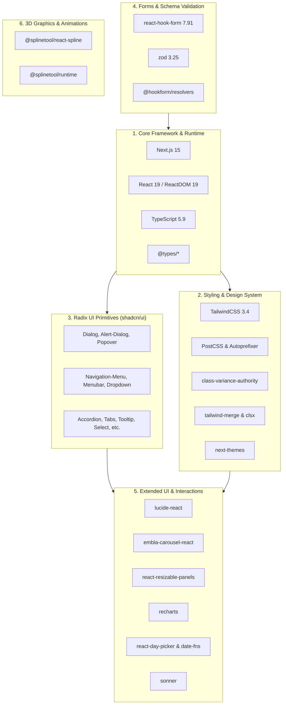

# Package Upgrade Guideline & Dependency Map

This document outlines the package version audit, functional grouping, phased upgrade roadmap, and verification procedure for **Tiara Portfolio**.

---

## 1. Upgrade Summary & Current Status

The upgrade roadmap follows a three-stage progression:
1. **Phase 1 (Patch Updates)**: Applied bug fixes within existing major.minor tracks. *(Verified & Committed)*
2. **Phase 2 (Minor Updates)**: Applied backwards-compatible features and improvements. *(Verified & Committed)*
3. **Phase 3 (Major Updates)**: Evaluated 14 major updates with breaking changes and migration roadmaps below.

```
[Phase 1: Patch] ✅ COMPLETED (Build Passed)
       │
       ▼
[Phase 2: Minor] ✅ COMPLETED (Build Passed: Next.js 15.5.29 / React 19.3.1)
       │
       ▼
[Phase 3: Major] ⚠️ EVALUATED & PLANNED (Requires Code Migration for Tailwind v4, DayPicker v10, Next 16)
```

> [!NOTE]
> All changes have been committed onto a dedicated git branch: `chore/package-updates`. You can test and inspect everything without affecting `main`.

---

## 2. Functional & Relational Grouping

The 57 dependencies are categorized into 6 functional groups based on their architectural role:



### Group Details:
1. **Core Framework & Runtime**: Foundational application framework (Next.js App Router), React 19 view library, TypeScript compiler, and Node/React type definitions.
2. **Styling & Design System**: The utility CSS engine (Tailwind CSS), PostCSS transformer, dynamic class utilities (`clsx`, `tailwind-merge` via the `cn()` helper), variant helper (`class-variance-authority`), and dark mode provider (`next-themes`).
3. **Radix UI Primitives**: 27 accessible, unstyled UI primitives powering the `components/ui/*` design system (Dialogs, Dropdowns, Select, Tooltips, Tabs, etc.).
4. **Forms & Schema Validation**: `react-hook-form` state handling, `zod` declarative schema validation, and `@hookform/resolvers` bridging the two.
5. **Extended UI & Interactions**: Specialized interactive widgets including `lucide-react` iconography, `embla-carousel` for project sliders, `react-day-picker` for date selection, `recharts` for charts, and `sonner` / `vaul` for overlays.
6. **3D Graphics & Animations**: `splinetool` runtime and React wrapper for embedding interactive Spline 3D scenes.

---

## 3. Dependency Inventory & Version Matrix

| Package Name | Functional Group | Original Version | Phase 1 (Patch) | Phase 2 (Minor) | Phase 3 (Major Available) |
| :--- | :--- | :--- | :--- | :--- | :--- |
| `next` | Core Framework | 15.2.4 | 15.2.9 | **15.5.29** | 16.4.5 |
| `react` | Core Framework | ^19 (19.1.0) | 19.1.10 | **19.3.1** | 19.3.1 |
| `react-dom` | Core Framework | ^19 (19.1.0) | 19.1.10 | **19.3.1** | 19.3.1 |
| `typescript` | Core Framework | ^5 (5.8.3) | 5.8.3 | **5.9.3** | 7.0.2 |
| `@types/node` | Core Framework | ^22 (22.15.3) | 22.15.35 | **22.20.5** | 26.6.6 |
| `@types/react` | Core Framework | ^19 (19.1.2) | 19.1.17 | **19.3.0** | 19.3.0 |
| `@types/react-dom` | Core Framework | ^19 (19.1.3) | 19.1.11 | **19.3.0** | 19.3.0 |
| `tailwindcss` | Styling | ^3.4.17 | 3.4.19 | **3.4.19** | 4.3.4 |
| `postcss` | Styling | ^8 (8.5.3) | 8.5.32 | **8.5.32** | 8.5.32 |
| `autoprefixer` | Styling | ^10.4.20 | 10.4.27 | **10.6.2** | 10.6.2 |
| `tailwindcss-animate` | Styling | ^1.0.7 | 1.0.7 | **1.0.7** | 1.0.7 |
| `tailwind-merge` | Styling | ^2.5.5 | 2.6.1 | **2.6.1** | 3.7.0 |
| `clsx` | Styling | ^2.1.1 | 2.1.1 | **2.1.1** | 2.1.1 |
| `class-variance-authority` | Styling | ^0.7.1 | 0.7.1 | **0.7.1** | 0.7.1 |
| `next-themes` | Styling | ^0.4.4 | 0.4.6 | **0.4.6** | 0.4.6 |
| `@radix-ui/react-accordion` | Radix UI | 1.2.2 | 1.2.21 | **1.3.1** | 1.3.1 |
| `@radix-ui/react-alert-dialog` | Radix UI | 1.1.4 | 1.1.24 | **1.2.1** | 1.2.1 |
| `@radix-ui/react-aspect-ratio` | Radix UI | 1.1.1 | 1.1.16 | **1.2.0** | 1.2.0 |
| `@radix-ui/react-avatar` | Radix UI | 1.1.2 | 1.1.12 | **1.3.1** | 1.3.1 |
| `@radix-ui/react-checkbox` | Radix UI | 1.1.3 | 1.1.5 | **1.4.1** | 1.4.1 |
| `@radix-ui/react-collapsible` | Radix UI | 1.1.2 | 1.1.21 | **1.2.1** | 1.2.1 |
| `@radix-ui/react-context-menu` | Radix UI | 2.2.4 | 2.2.16 | **2.4.1** | 2.4.1 |
| `@radix-ui/react-dialog` | Radix UI | 1.1.4 | 1.1.23 | **1.3.1** | 1.3.1 |
| `@radix-ui/react-dropdown-menu` | Radix UI | 2.1.4 | 2.1.25 | **2.2.1** | 2.2.1 |
| `@radix-ui/react-hover-card` | Radix UI | 1.1.4 | 1.1.24 | **1.2.1** | 1.2.1 |
| `@radix-ui/react-label` | Radix UI | 2.1.1 | 2.1.17 | **2.1.17** | 2.1.17 |
| `@radix-ui/react-menubar` | Radix UI | 1.1.4 | 1.1.25 | **1.2.1** | 1.2.1 |
| `@radix-ui/react-navigation-menu` | Radix UI | 1.2.3 | 1.2.22 | **1.4.1** | 1.4.1 |
| `@radix-ui/react-popover` | Radix UI | 1.1.4 | 1.1.23 | **1.3.1** | 1.3.1 |
| `@radix-ui/react-progress` | Radix UI | 1.1.1 | 1.1.17 | **1.2.1** | 1.2.1 |
| `@radix-ui/react-radio-group` | Radix UI | 1.2.2 | 1.2.4 | **1.5.1** | 1.5.1 |
| `@radix-ui/react-scroll-area` | Radix UI | 1.2.2 | 1.2.18 | **1.4.0** | 1.4.0 |
| `@radix-ui/react-select` | Radix UI | 2.1.4 | 2.1.7 | **2.4.1** | 2.4.1 |
| `@radix-ui/react-separator` | Radix UI | 1.1.1 | 1.1.16 | **1.2.0** | 1.2.0 |
| `@radix-ui/react-slider` | Radix UI | 1.2.2 | 1.2.4 | **1.6.1** | 1.6.1 |
| `@radix-ui/react-slot` | Radix UI | 1.1.1 | 1.1.2 | **1.5.0** | 1.5.0 |
| `@radix-ui/react-switch` | Radix UI | 1.1.2 | 1.1.4 | **1.4.1** | 1.4.1 |
| `@radix-ui/react-tabs` | Radix UI | 1.1.2 | 1.1.22 | **1.2.1** | 1.2.1 |
| `@radix-ui/react-toast` | Radix UI | 1.2.4 | 1.2.24 | **1.3.1** | 1.3.1 |
| `@radix-ui/react-toggle` | Radix UI | 1.1.1 | 1.1.19 | **1.2.1** | 1.2.1 |
| `@radix-ui/react-toggle-group` | Radix UI | 1.1.1 | 1.1.20 | **1.2.1** | 1.2.1 |
| `@radix-ui/react-tooltip` | Radix UI | 1.1.6 | 1.1.8 | **1.4.1** | 1.4.1 |
| `react-hook-form` | Forms | ^7.54.1 | 7.56.4 | **7.91.0** | 7.91.0 |
| `@hookform/resolvers` | Forms | ^3.9.1 | 3.10.0 | **3.10.0** | 7.0.3 |
| `zod` | Forms | ^3.24.1 | 3.24.4 | **3.25.76** | 4.6.7 |
| `lucide-react` | UI Components | ^0.454.0 | 0.454.0 | **0.577.0** | 1.69.0 |
| `cmdk` | UI Components | 1.0.4 | 1.0.4 | **1.1.1** | 1.1.1 |
| `date-fns` | UI Components | 4.1.0 | 4.1.0 | **4.4.0** | 4.4.0 |
| `embla-carousel-react` | UI Components | 8.5.1 | 8.5.2 | **8.6.0** | 8.6.0 |
| `input-otp` | UI Components | 1.4.1 | 1.4.2 | **1.5.0** | 1.5.0 |
| `react-day-picker` | UI Components | 8.10.1 | 8.10.2 | **8.10.2** | 10.0.2 |
| `react-resizable-panels` | UI Components | ^2.1.7 | 2.1.9 | **2.1.9** | 4.18.1 |
| `recharts` | UI Components | 2.15.0 | 2.15.4 | **2.15.4** | 3.10.1 |
| `sonner` | UI Components | ^1.7.1 | 1.7.4 | **1.7.4** | 2.0.8 |
| `vaul` | UI Components | ^0.9.6 | 0.9.9 | **0.9.9** | 1.1.2 |
| `@splinetool/react-spline` | 3D Graphics | ^4.0.0 | 4.0.0 | **4.2.0** | 4.2.0 |
| `@splinetool/runtime` | 3D Graphics | ^1.9.95 | 1.9.99 | **1.12.98** | 2.0.144 |

---

## 4. Node.js Runtime Caveat & Environment Setup

> [!WARNING]
> Your Windows system default Node path (`C:\Program Files\nodejs\node.exe`) points to **Node.js 16.19.1**, which fails Next.js 15+ build requirements (`>= 18.18.0`).
> However, an updated Node.js **v22.23.2** is installed at:
> `C:\Users\LENOVO\AppData\Local\hermes\node\node.exe`

### How to run commands using Node 22:
In PowerShell:
```powershell
$env:PATH = "C:\Users\LENOVO\AppData\Local\hermes\node;$env:PATH"
node -v   # Should output v22.23.2
yarn dev  # Runs development server
yarn build # Builds production bundle
```

---

## 5. Phase 3: Major Updates & Breaking Changes Analysis

There are **14 packages** with available major updates. Unlike patches and minors, these contain breaking changes and require focused manual refactoring.

### High-Impact Major Upgrades:

#### 1. `tailwindcss` (3.4 -> 4.3) & `tailwind-merge` (2.6 -> 3.7)
* **Breaking Changes**:
  * Tailwind v4 replaces `tailwind.config.ts` with CSS-first `@theme` configuration.
  * Direct directives `@tailwind base;` are replaced with `@import "tailwindcss";`.
  * `tailwindcss-animate` is superseded.
* **Recommendation**: Keep on **Tailwind v3.4.19** until dedicated stylesheet migration is performed.

#### 2. `react-day-picker` (8.10 -> 10.0)
* **Breaking Changes**:
  * Complete API redesign in v9 and v10. Props like `mode="single"`, `selected`, `onSelect`, custom navigation components, and CSS class structures changed completely.
  * `components/ui/calendar.tsx` (the shadcn calendar) expects DayPicker v8.
* **Recommendation**: Stay on **v8.10.2** unless replacing or updating shadcn's calendar component.

#### 3. `next` (15.5 -> 16.4)
* **Breaking Changes**:
  * Changes to asynchronous request APIs (`cookies()`, `headers()`, dynamic route params).
  * Strict React 19 canary server component features.
* **Recommendation**: The project currently runs cleanly on **Next.js 15.5.29**. Verify all App Router routes before upgrading to Next.js 16.

#### 4. `zod` (3.25 -> 4.6) & `@hookform/resolvers` (3.10 -> 7.0)
* **Breaking Changes**:
  * Zod v4 altered schema inference types and error map formatting.
  * Must be upgraded synchronously with `@hookform/resolvers` 7.x.
* **Recommendation**: If form validation in contact or project forms is stable, keep on **Zod 3.25.76** until ready to update resolver schemas.

#### 5. `lucide-react` (0.577 -> 1.69)
* **Breaking Changes**:
  * Several deprecated icon aliases removed or renamed in 1.x.
* **Recommendation**: Upgrade only after checking all icon imports in `components/`.

---

## 6. Verification Checklist

Whenever verifying updates, complete these four checks:

- [x] **Install Consistency**: `yarn install` runs with 0 unresolved dependencies.
- [x] **Type Safety**: TypeScript compiler succeeds (`typescript` 5.9.3).
- [x] **Production Build**: `yarn build` creates all static SSG routes (`/`, `/projects/[slug]`).
- [ ] **Interactive Visual Checks** (`yarn dev`):
  - [ ] Navbar and mobile menu responsiveness.
  - [ ] Dark / Light mode toggle (`next-themes`).
  - [ ] Spline 3D canvas rendering on the hero section.
  - [ ] Project detail carousel / modal dialogs.
  - [ ] Contact form submission and toast alerts (`sonner`).
